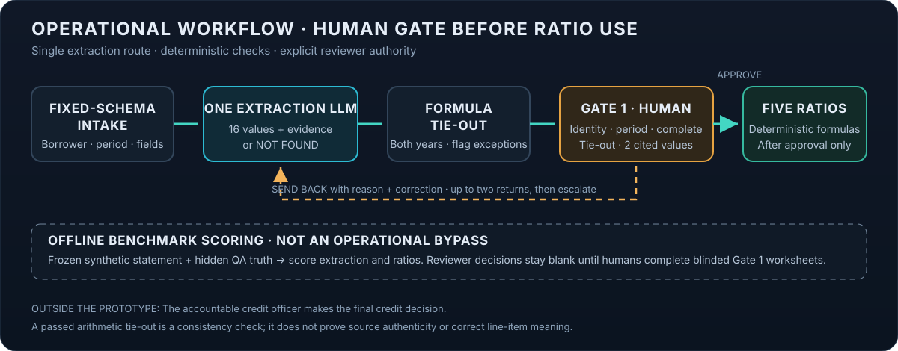
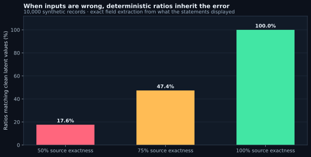
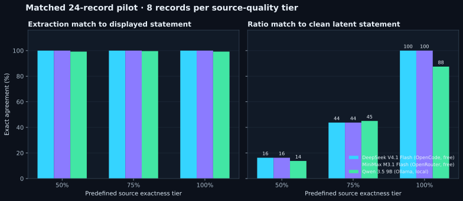
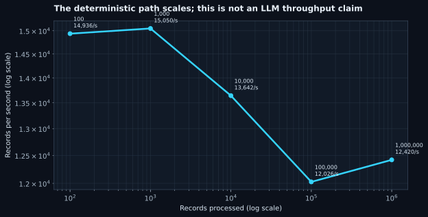
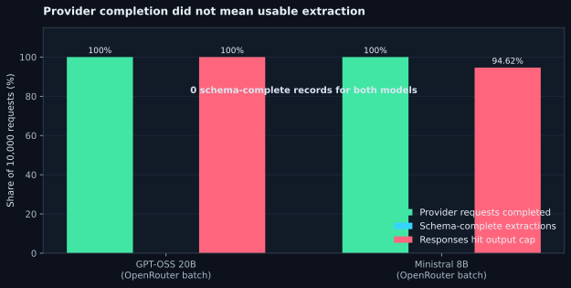

# Governing an AI-Assisted Credit Memo Workflow

## A case study in controls, source quality, and model measurement

**Updated research edition · October 2026**
**Research phase: Measure**

> **What this study finds.** A model can copy every number shown in a financial statement and still produce ratios that disagree with the clean underlying financials when the source itself is defective. In a controlled 10,000-record synthetic cohort, exact extraction from the displayed statements was 100%, while clean-latent ratio agreement was 17.6%, 47.4%, and 100% across preassigned 50%, 75%, and 100% source-quality tiers. Small model pilots reproduced that pattern. A separate 10,000-request LLM batch exercise then showed that successful provider completion does not guarantee usable, schema-valid output: neither model returned a schema-complete extraction under the chosen output cap.

This is a research extension of the original case study, not a production validation. It preserves the original linear workflow and financial definitions. It adds a controlled synthetic benchmark and records where our evidence is still too limited to support a model ranking.

## 1. The use case and its boundary

Credit analysts spend time locating financial statement items in public filings and transferring them into credit memos. The prototype studied here automates that preparation step while keeping a person responsible for review and the eventual credit decision.

The workflow has four built steps:

1. **Intake agent:** captures the requested borrower, loan amount, purpose, and term, and flags missing or suspicious inputs.
2. **Data retrieval agent:** reads a public Form 10-K and returns 16 financial figures for the current and prior fiscal years, with page citations or an explicit `NOT FOUND` result.
3. **Formula tie-out and Gate 1:** a formula checks the income-statement relationship; a human reviewer checks borrower, period, completeness, tie-out, and two cited figures. The reviewer approves or sends the extraction back. After two send-backs, the next failure escalates.
4. **Ratio calculator:** deterministic formulas calculate five ratios only after Gate 1 approval.

The AI does not make a credit decision, assign a risk rating, or approve the loan. Industry research, memo drafting, a critic, and the final credit-officer decision Gate 2 are designed ideas, not built or tested stages. This work covers **Measure** in the Measure → Standardize → Optimize → Innovate → Scale research framework. It does not introduce model swarms, JEV routing, or a new decision architecture.



**Approval boundary.** The reviewer checks borrower identity, filing period, completeness, the two-year tie-out, and two cited values. Approval permits downstream ratio use; a send-back includes a reason and correction, with escalation after repeated failure. For benchmark evaluation only, ratios are also calculated offline against hidden clean truth. That scoring path does not bypass the operational human gate, and no reviewer decision is simulated.

The original case study used Microsoft's public FY2026 10-K as a test filing. The benchmark extension uses synthetic statements only. No borrower or customer records were used in the benchmark.

## 2. Why governance controls mattered in the original build

The initial prototype exposed a distinction between a plausible answer and a correct one. The agent once reported operating income of $188.3 billion instead of $155.2 billion and cited the correct filing page. A valid-looking citation did not prove that the number on the page had been transcribed correctly. A later version mapped lease interest to interest expense, which changed interest coverage from 50.9x to 60.9x. That error could pass a consistency tie-out because the tie-out checks arithmetic relationships, not the meaning of the line item.

Other negative tests found a tie-out that passed on all-zero inputs, a human approval path that accepted a record with all 16 figures missing, a human question that could be skipped because of a platform default, and an injection attempt that was ignored but not flagged. The workflow was changed to show `INPUT MISSING - FAIL`, block approval when any item is missing, make Gate 1 ask every time, identify suspicious input, and cap send-back loops.

The eight documented findings and their fixes were:

| Finding | Why it mattered | Control or response |
|---|---|---|
| Fabricated operating income with a real page citation | Interest coverage could make the borrower look stronger than it was | Figure re-check, formula tie-out, Gate 1 spot checks |
| Lease interest mapped as interest expense | Interest coverage changed from 50.9x to 60.9x | Exact line-item definition; exclude lease interest |
| Tie-out passed on empty/zero data | A control could certify numbers that did not exist | Explicit missing-input failure state |
| Reviewer approved all 16 `NOT FOUND` fields | Human approval could be rubber-stamped | System blocks approval when a required figure is missing |
| Agent passed a standalone test but failed in the workflow | Component testing did not represent actual configuration | Separate statement searches; ignore loan terms; workflow regression test |
| Removing the 10-K silently changed agent versions | Source data was outside version control | Change control and full regression after source changes |
| Default setting could skip the human approval question | Gate 1 was not guaranteed to occur | Set the question to always ask and confirm its behavior |
| Injection attempt was ignored but not flagged | An attack could pass without an audit signal | Flag suspicious input; retest was limited to one example |

The original agent evolved through text output, broader MD&A/note searches, a self-check and tie-out, JSON schema output, exact line-item definitions, and separate searches for each statement. An improvement in a standalone prompt once caused a workflow failure, which is why the final regression had to run inside the actual workflow. In the original Microsoft example, the hand-calculated results were:

| Ratio | FY2026 | FY2025 |
|---|---:|---:|
| Interest coverage | 50.88x | 53.89x |
| Current ratio | 1.23 | 1.35 |
| Debt-to-equity | 0.09 | 0.13 |
| Total debt / EBITDA | 0.21x | 0.27x |
| Net margin | 40.3% | 36.1% |

These are reproduced here as the original case study's example outputs, not recalculated benchmark outcomes.

The final developer retest in the original single-filing case study reported all 16 figures correct and all five ratios matching its hand-calculated answer key. That is useful evidence about a controlled workflow and one filing. It is not evidence of general accuracy across companies, filing formats, or source defects. The benchmark below was designed to examine that wider source-quality question.

## 3. Risk and intended use

The original case study proposed treating the workflow as a model for model-risk governance because it transforms source data into quantitative estimates that inform lending work. Its proposed initial risk tier was medium, subject to independent model-risk review. Risk would rise if human review were removed, the system started drafting recommendations, or outputs were used at volume for large exposures.

The intended use remains analyst decision support. Prohibited uses include approving or declining credit, assigning risk ratings, consumer lending, or use without Gate 1. The prototype is not validated or approved for production. The original case study also identifies fair-lending, security, traceability, vendor dependence, and source-version risks that remain relevant even though the synthetic benchmark does not test those risks.

## 4. Architecture and financial definitions retained

The benchmark mirrors the source's linear sequence: fixed-schema statement intake → one data-retrieval model → deterministic gross-margin tie-out → Gate 1 review worksheet → deterministic ratios. Candidate models receive the same immutable record independently. They do not see hidden ground truth or the quality-assurance sidecar. The benchmark scorer compares outputs only after inference.

There are 16 financial line items for two years (32 numeric positions per record). The five ratios are calculated outside the LLM using the source definitions:

| Ratio | Formula used |
|---|---|
| Interest coverage | Operating income ÷ interest expense |
| Current ratio | Total current assets ÷ total current liabilities |
| Debt-to-equity | (Current portion of long-term debt + long-term debt) ÷ stockholders' equity |
| Total debt / EBITDA | (Current portion of long-term debt + long-term debt) ÷ (operating income + depreciation, amortization, and other) |
| Net margin | Net income ÷ total revenue |

**Total debt excludes leases.** **EBITDA** is operating income plus “depreciation, amortization, and other” from the cash-flow statement. These definitions are inherited from the source workflow; they are not a new credit policy or a claim that one definition is universally preferred. As in the source, interest expense is the line labeled exactly “Interest expense,” is represented as a positive number, and is not replaced with lease interest.

The pre-ratio gross-margin tie-out is gross margin − research and development − sales and marketing − general and administrative − operating income = 0 for each year. It tests internal consistency, not whether a value was assigned the right accounting meaning. The human Gate 1 checks borrower, filing period, missing fields, both years' tie-out, and two figures against cited source pages. Gate 1 approves data quality; it does not approve the loan.

## 5. Benchmark design: vary source quality on purpose

The fixed synthetic quality-mix corpus contains 10,000 records, generated with seed `20261020`. It is one cohort, divided evenly across three predefined source-quality levels: 3,333 records at 50% numeric exactness, 3,333 at 75%, and 3,334 at 100%. Every record has 32 current/prior-year numeric positions. At the 50% tier exactly 16 positions match the clean latent record; at 75%, exactly 24; at 100%, all 32.

The mutations are planned into the data before inference. They cycle through five defined classes: OCR-like digit changes, decimal shifts, unit-scale mistakes, period misalignment, and substitution from an adjacent line. The synthetic filing text varies across eight layouts, line order, labels, currency/comma formatting, distractor values, and note references. A QA sidecar records each defect and its original clean value. The model receives only the statement text and record ID. Ground truth is stored separately.

This design makes two notions of accuracy visible:

- **Extraction fidelity:** did the model reproduce the value displayed in its statement?
- **Clean-latent agreement:** do extracted values and resulting ratios agree with the clean underlying synthetic record?

Those measures answer different questions. A model should not be penalized for faithfully copying a deliberately corrupted statement when scored on extraction fidelity. At the same time, perfect copying alone cannot tell an analyst whether the statement's source values are themselves sound. The quality tiers are controlled stress levels, not estimates of how often real financial filings contain errors.

## 6. What the 10,000-record run says—and does not say

On the 10,000-record synthetic quality-mix corpus, deterministic readback matched all 320,000 displayed numeric fields. The formula calculator matched every ratio calculated from the displayed inputs. Against the clean latent values, however, only 55.01% of the 100,000 ratio-year outputs agreed overall: 17.64% in the 50% tier, 47.37% in the 75% tier, and 100% in the clean tier (Figure 1).

This is the clearest result of the experiment: **arithmetic correctness is conditional on input quality.** Deterministic calculations remove one source of model variability, but they cannot repair incorrect source values. A tie-out is still useful as a consistency control, but it is not a source-authenticity control. Some planned defects caused tie-out failures; others can remain internally consistent and still be wrong.

The 10,000-record simulator completed in 3.96 seconds (about 2,525 records per second) on this run. It reported 11,721 tie-out failures and 6,541 records with a control-failure flag. Those are consequences of the intentionally varied synthetic corpus, not LLM errors or observed defect rates in real filings. Full per-tier counts and hashes are in `results/simulator-quality-mix-10000.json`.



**Figure 1. Source quality and downstream ratio agreement.** The simulator extracted every displayed number and calculated ratios deterministically. Clean-latent ratio agreement was 17.64% at 50% source exactness, 47.37% at 75%, and 100% at 100%. The 50% tier's ratio agreement is not simply 50% because the locations and interactions of altered fields matter to each formula.

## 7. Small matched model pilot

Three routes completed a comparable, stratified pilot against the same 24 records: eight per tier and one example from each of eight layouts within each tier. All comparisons below use the same cohort. The model outputs were independently normalized, scored against displayed values, and passed into the same deterministic formulas. This sample is useful for screening but too small to rank models or estimate production performance.

| Model and route | Exact extraction vs. displayed source (50% / 75% / 100%) | Clean-latent ratio agreement (50% / 75% / 100%) | Total time | Tokens reported | Gate 1 control flags |
|---|---:|---:|---:|---:|---:|
| DeepSeek V4.1 Flash Free · OpenCode | 100% / 100% / 100% | 16.25% / 43.75% / 100% | 190.1 s | 395,075 | 17 |
| MiniMax M3.1 Flash Free · OpenRouter | 100% / 100% / 100% | 16.25% / 43.75% / 100% | 318.4 s | 59,775 | 19 |
| Qwen 3.5 9B · local Ollama | 99.22% / 99.61% / 99.22% | 13.75% / 45.00% / 87.50% | 427.9 s | 40,500 | 24 |

The two free hosted routes reproduced the displayed values exactly in this 24-row sample; Qwen was close but had two schema failures across the sample. Across models, clean-latent ratio agreement broadly followed the source tier. This is expected when a model faithfully transcribes the statement and the formulas are held fixed. The small differences—especially Qwen's 87.5% on the nominally clean tier—are a reason to inspect field-level and schema failures, not to declare a winner from eight observations.



**Figure 2. Matched model screening sample.** Bars summarize the same 24-record cohort for each model, not separate or resized cohorts. The exact per-tier rates are in `results/quality_sensitivity.csv`; use the [interactive benchmark dashboard](../dashboard/index.html) for metric and model filtering.

### Reliability and scale evidence outside the matched quality pilot

Separate route smoke tests on the ordinary synthetic cohort are also recorded in `results/summary.csv`. DeepSeek completed a 100-record run at 99% numeric-field and ratio agreement, with one failed response and six control failures, taking 746.0 seconds. This is not directly comparable to the 24-row quality-mix results because it is a different corpus. The 100-, 1,000-, 10,000-, 100,000-, and 1,000,000-record simulator runs all reported 100% agreement on their deterministic path. The million-record run took 80.52 seconds. Those runs measure deterministic processing at scale, not million-record LLM inference.



**Figure 3. Deterministic simulator scaling.** This is a local simulator timing and must not be interpreted as model inference throughput. Synthetic input format remains simpler than full 10-K retrieval: the benchmark does not yet establish performance on a real filing corpus, citations, notes search, or restatements.

## 8. Full-cohort batch attempt: provider success is not extraction success

To test the entire identical 10,000-record cohort through low-cost batch routes, the benchmark submitted one independent request per record to OpenRouter Batch for GPT-OSS 20B and Ministral 8B. Both jobs completed all 10,000 provider requests without provider-level failures. They used the same frozen statement and truth hashes. This is the full-cohort comparison the small pilot cannot provide—but the configured completion budget was too low for the required JSON object.

| Model | Requests completed | Output hit cap | JSON parse or schema outcome | Cost | Elapsed batch time |
|---|---:|---:|---|---:|---:|
| GPT-OSS 20B Batch | 10,000 / 10,000 | 10,000 | 10,000 JSON parse failures; 0 schema-complete | $0.883748 | 2,271 s |
| Ministral 8B Batch | 10,000 / 10,000 | 9,462 | 9,461 JSON parse failures; 539 parsed but incomplete; 0 schema-complete | $0.948817 | 1,440 s |

The runner had set the output cap to 640 tokens. Every GPT-OSS response and most Ministral responses were length-limited; neither model produced a schema-complete record. We therefore report **no valid accuracy measurement** for these two batches. Their source-field and ratio accuracy fields are not usable as quality scores. The batch jobs are evidence of an output-budget/configuration failure, not evidence that the models have zero accuracy.



**Figure 4. Output integrity on the 10,000-request batches.** Provider completion reached 100%, but schema-complete extractions were zero for both models. The chart shows why transport success must be separated from parse, schema, and semantic correctness.

The experiment spent **$1.834534 of the $2.00 cap**, leaving $0.165466 and no reserved balance. The ledger includes a small earlier DeepSeek probe and its conservatively charged interrupted request. The batch runner now defaults to 1,600 output tokens and refuses a submission that exceeds the spend ledger, but a new full-corpus run at the safer output cap does not fit the remaining budget. The batch outputs and provider metadata remain preserved for audit and excluded from accuracy charts.

This suggests a practical efficiency lesson. The ratios are simple formulas, and should remain formulas. LLM cost is driven by repeatedly sending statement context and producing structured outputs for every record, not by arithmetic. Before another large inference, reduce unnecessary prompt/output tokens, validate a few responses end-to-end with the final schema and cap, estimate against observed usage, and only then expand. Do not infer that two batch models can be compared on accuracy when both failed the same output contract.

## 9. Where the human review fits

Gate 1 is the operational human checkpoint between extraction and ratio use. The reviewer verifies identity, filing period, completeness, two-year tie-out, and two source figures. An approval cannot override missing data; a send-back carries a reason; repeated failure escalates. In the benchmark, blinded Gate 1 worksheets are generated, but the reviewer decision fields remain blank. **Human review burden and reviewer effectiveness have not yet been measured.** Automated flags are not a substitute for the human's source checks, and they do not tell us whether reviewers would notice or correct an error.

The benchmark calculates ratios offline to score outputs against ground truth even though the production-shaped workflow calculates them only after Gate 1 approval. That offline scoring is an evaluation step, not a bypass of the intended human gate.

## 10. What we learned

1. **Source quality can dominate downstream accuracy.** At lower source tiers, even perfect field extraction gives inaccurate ratios relative to the clean record.
2. **A tie-out verifies consistency, not meaning or provenance.** It can catch some defects, but it cannot prove that the source figure is correct or mapped to the right accounting label.
3. **Deterministic math is the right boundary for this prototype.** It makes formulas reproducible and auditable, but does not solve source errors.
4. **Provider success is only one stage of output quality.** Valid extraction also requires completion without truncation, parseable JSON, schema compliance, field-level source agreement, and downstream control checks.
5. **Matched cohorts are essential.** Models must receive the same records and truth hashes before differences can be attributed to the model route.
6. **Small free/local pilots screen feasibility, not deployment readiness.** They are useful for learning safely, but limited samples, free-tier throttling, prompt-format issues, and pending human review constrain conclusions.
7. **The million-record result is about the simulator.** It demonstrates deterministic scale behavior only; no million-record LLM inference run has completed.

## 11. Limits, governance, and next research steps

This benchmark uses synthetic financial data and deliberately assigned errors, not a representative sample of actual filings. Its filing-like formats are still simplified: it does not test full 10-K search, source-page citation correctness, footnote and segment interpretation, restatements, or the range of issuer-specific accounting presentations. The 24-record model sample is too small for ranking. The two 10,000-request batches have zero usable records for accuracy scoring. Human Gate 1 decisions are pending. None of these results supports production use or a credit decision.

The most important unresolved architecture question from the independent review remains: downstream checks depend on data created by the retrieval model. A governed financial-data layer, controlled source snapshots, precise citations or quoted evidence per value, an approved data dictionary, independent semantic checks, and documented exception authority remain production prerequisites. Migration off a platform scheduled for retirement on December 1, 2026 is also part of the original case study's vendor-risk plan.


## 12. The article series: planned tests and results

This case study is the opening **Measure** article. The next articles will advance one research question at a time, keep results and plans distinct, and publish the cohort, prompt/configuration, provider route, spend, failures, and limitations alongside accuracy. All model comparisons will use the same frozen records and hidden truth for every candidate. The current model pilots and invalid batch attempts will remain labeled as such; later results will not retroactively turn them into a valid full-cohort comparison.

| Planned article | Framework stage | Question and planned test | What will be reported | Entry condition |
|---|---|---|---|---|
| **1. Measure the baseline** *(this article)* | Measure | How do controlled source-quality tiers affect exact extraction, downstream ratios, controls, time, tokens, and cost? | Simulator results, the matched 24-record pilot, output-integrity failures, spend, and known limits | Complete; limited model pilot only |
| **2. Complete the matched model comparison** | Measure | With a valid output budget and schema, how do candidate models perform on the identical 10,000-record corpus? | Per-tier field and ratio agreement, schema and call failures, latency, throughput, tokens, provider cost, and identical input/truth hashes | First pass a tiny schema/output smoke check; any paid run must have an explicit adequate budget. Only $0.165466 remains under the existing $2 cap, which is not enough for another full paid pass. |
| **3. Measure Gate 1 in practice** | Measure | What does a human reviewer catch, correct, send back, or approve when shown blinded extractions and evidence? | Reviewer accuracy against the QA key, false approvals, missed defects, correction/send-back/escalation rates, and review time; reviewer identity and workload handled appropriately | Human reviewers complete blinded worksheets; no approval or effectiveness will be simulated |
| **4. Standardize the financial data contract** | Standardize | How much do explicit units, period definitions, line-item mappings, source citations, and missing-value conventions reduce avoidable ambiguity? | A versioned dictionary/schema and predeclared tests for fiscal periods, units, debt/lease treatment, EBITDA inputs, restatements, and evidence per value | Approve the definitions and scoring rules before testing; retain the original source formulas unless a documented change is approved |
| **5. Optimize the measured workflow** | Optimize | Can prompt length, output format, batching, or request settings reduce cost and latency without degrading extraction, controls, or reviewability? | Same-cohort quality and control measures alongside tokens, cost, throughput, truncation, and schema completion | A valid Measure baseline and Standardize contract; change one optimization at a time |
| **6. Test a bounded oversight innovation** | Innovate | After the single-model baseline is reliable, does an independent second-pass check identify errors that the existing tie-out and Gate 1 checks miss? | Incremental detection, false alarms, latency, cost, evidence shown to the reviewer, and added human workload | Separate preregistered experiment; retain the linear single-model benchmark as the control. No swarm, JEV routing, or cascade is part of the current experiment |
| **7. Test operational scale** | Scale | How do validated routes behave as the identical workload grows from 100 to 1,000, 10,000, 100,000, and eventually 1,000,000 records? | Completion and failure rates, queue time, throughput, latency distribution, token/cost totals, and Gate 1 review capacity | First establish valid outputs and cost controls at smaller scale; each paid expansion needs a budget preflight and must stop before exceeding its approved cap |

The human review article is deliberately separate from model scoring. A model can extract accurately while a reviewer misses a defect; a reviewer can catch a defective source that no extraction model can repair. We will measure those mechanisms separately and then show how they interact, rather than collapsing them into one accuracy score.

The study will share negative results as well as successful runs: unavailable routes, rate limits, invalid schemas, uncertain token/cost reporting, cohort mismatches, and tests stopped by the spend cap are all part of the evidence. A phase advances only when its entry condition is met and the result can be reproduced from the saved inputs, truth, configuration, and scoring rules. Future-stage tests are plans; no findings above should be read as results from them.

## 13. Reproducibility and audit trail

The project retains the frozen synthetic inputs, separately stored truth, QA sidecar, deterministic result JSONs, model responses, batch state, spend ledger, summary CSVs, and chart-source CSVs. The quality-mix input SHA-256 is `d288e317576cc95a3ccaaa8ffd80cd0da42ac0a6b549d22fb595c42e5fbc0bbb`; the truth SHA-256 is `ed89602f6a34317187521b3dd4aa74dc9ac4724a58899f607e596d1efae6f331`. The seed is `20261020`.

Run from the `benchmark-v1` directory in PowerShell with Python 3.11+:

```powershell
python src/freeze_dataset.py --profile quality-mix 10000
python src/benchmark.py --records 10000 --inputs data/statements-quality-mix-10000.jsonl --truth data/ground-truth-quality-mix-10000.jsonl --model simulator --summary-only
python src/build_graph_data.py
python src/plot_results.py
python src/build_article_figures.py
python -m http.server 8765 --directory dashboard
```

The generator is deterministic. Use existing frozen inputs and results when reproducing the published run, rather than silently replacing the measured cohort. The interactive dashboard is available at `http://localhost:8765`; article figures are SVGs in `article/figures/`. **Never run a paid batch again without checking `results/spend-ledger.json` and the configured preflight.** API keys are read from the environment and must not be placed in source files or results.

## Source, disclaimer, and status

This article extends *Governing an AI-Assisted Credit Memo Workflow: A Case Study* (original case study dated October 13, 2026; see the [original case study PDF](../../case-study/AI-Assisted-Credit-Memo-Case-Study.pdf)) and the exported workflow logic, schema, test log, and answer key preserved in the repository's `workflow/` and `testing/` folders. Original borrower test figures came from a public Form 10-K; all new benchmark records are synthetic.

This is a learning and research project. It is not credit, investment, or financial advice. The benchmark is not an independent model validation and is not approved for production use. The only complete one-million-record result is the deterministic simulator. The LLM quality comparison is a 24-record screening pilot, and the two full 10,000-request batches failed schema integrity and yield no valid accuracy comparison. Paid spend is $1.834534 against the authorized $2 cap.
